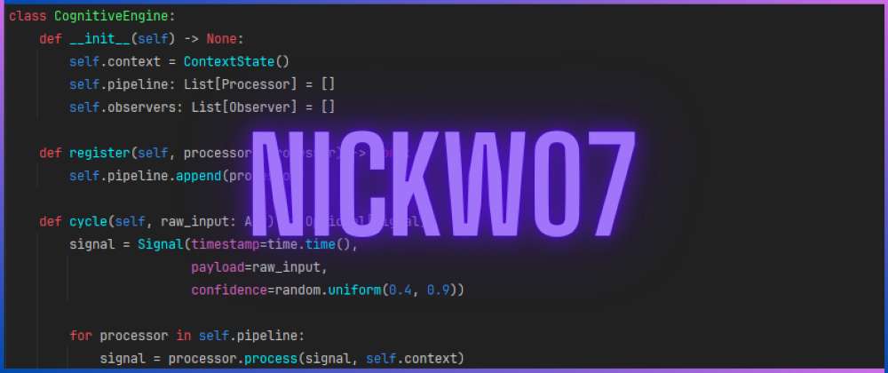

# Hi there 🤖

 

## 👤 About me

- 🚀 18 y.
- 🐍 Python is my primary programming language — currently improving my skills
- 🔐 Exploring Cybersecurity through hands-on labs and practical projects
- 🎓 Planning to study Computer Science with a focus on Cybersecurity in 2027
- 🚀 Building projects and documenting my learning journey

 

## 🌐 Socials
- 🔐 TryHackMe: [@nickw07](https://tryhackme.com/p/nicklaswagner33?utm_campaign=social_share&utm_medium=social&utm_content=profile&cardVersion=89118e9dbe0b&utm_source=copy&sharerId=69c6a465dfafc0d1d221a097)
- 🗨️ Discord: [@nick.07](https://discord.com/users/547078532384161802)
- ⌨️ Monkeytype: [@n1ck07](https://monkeytype.com/profile/n1ck07)

 

## 🛠️ | Working with ...

 

<h3>Check out my latest projects! ⤵️ </h3>
